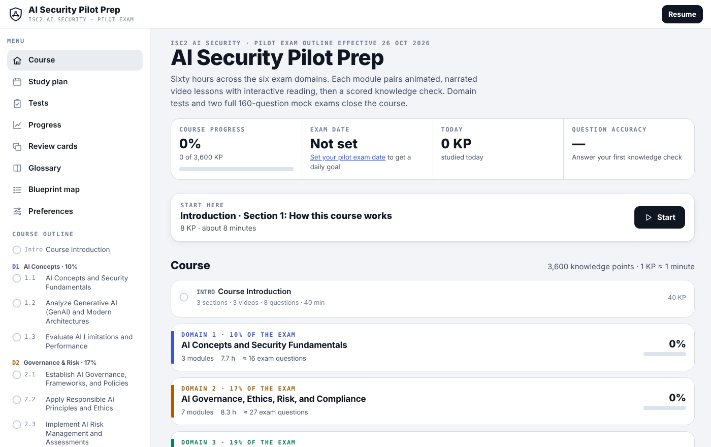
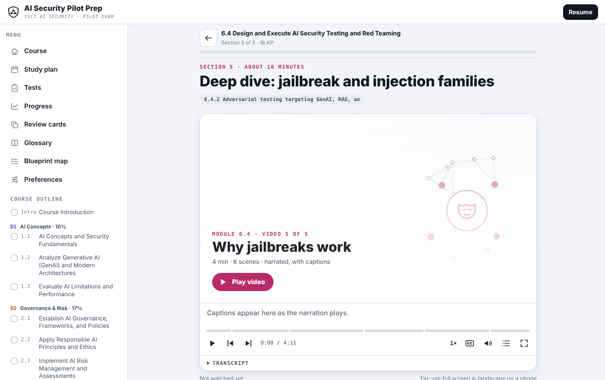
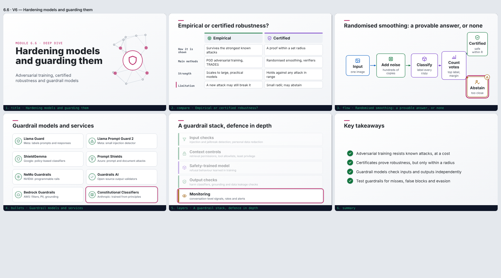

# AI Security Pilot Prep

A free, open, self-paced course for the **ISC2 AI Security pilot exam** (exam outline effective 26 October 2026). It covers all six domains with narrated, animated video lessons, interactive reading, knowledge checks, domain tests and two full 160-question mock exams.

It is a static website: no server, no accounts and no tracking. Your progress stays in your browser.

> **Unofficial.** This project isn’t affiliated with, endorsed by or reviewed by ISC2. See [Disclaimer](#disclaimer).



## At a glance

| | |
|---|---|
| Planned study time | 3,600 knowledge points (about 60 hours; 1 KP ≈ 1 minute) |
| Coverage | All 181 topics in the six-domain exam outline, mapped section by section |
| Lessons | 39 modules, 184 sections, about 110,000 words of reading |
| Video | 184 animated, narrated videos (about 10 hours), with captions and transcripts |
| Practice questions | 1,347 in total: 485 knowledge-check questions, 315 domain-test questions, 227 in-lesson checks and scenarios, and 320 mock exam questions |
| Mock exams | Two separate 160-question pools, weighted like the exam and timed at 3 hours |
| Glossary | 952 terms, linked to the modules that teach them |

## Features

- **Video lessons.** 184 explainer videos drawn as live, scalable graphics (21 scene types, including flows, charts, comparisons and attack chains). Narration is a recorded British English voice, so it works in any browser, including mobile apps that have no built-in speech. Captions, transcripts, playback speed and chapter navigation are included.
- **Play all videos (bonus).** Watch all 184 videos back to back in course order, like a playlist. The next video starts automatically after a five-second countdown. Quick checks can show their answer and carry on, and you can skip videos you’ve already watched or jump to any domain. Your place is remembered, and videos watched here count towards your lessons. **Listen mode** keeps the narration playing with the screen off or locked, for revision in the car or on a walk. It shows what’s playing on the lock screen, and the car’s, headphones’ or lock screen’s skip buttons move between videos.
- **Interactive reading.** Tables, flip cards, matching exercises, step-throughs, worked scenarios and exam tips in every section.
- **Exam-style questions.** Most questions are written as scenarios in ISC2’s BEST, MOST and FIRST style. Every question has an explanation, and options are shuffled each time.
- **Domain tests and mock exams.** Each domain has a test, and two mock exams are weighted by domain like the real one. Each mock is 46% judgement questions and 83–87% scenarios. After a mock you get a breakdown by domain.
- **Study plan.** Set your exam date and study days, and the plan spreads the remaining work across them.
- **Progress and review.** Track progress, accuracy and weak areas. Missed questions go into spaced-repetition review cards.
- **Blueprint map.** Shows every outline topic and where it is taught and tested.
- **Accessible by default.** Light theme by default, with dark and system themes, adjustable text size, full keyboard support and reduced-motion support.
- **Backups.** Copy or download your progress, and restore it on another device or browser.

| Lesson with video | Video scenes |
|---|---|
|  |  |

## Exam domains

| Domain | Exam weight | Modules | Planned study |
|---|---|---|---|
| 1. AI Concepts and Security Fundamentals | 10% | 1.1–1.3 | 7.0 h |
| 2. AI Governance, Ethics, Risk, and Compliance | 17% | 2.1–2.7 | 7.6 h |
| 3. AI Data Management, Privacy, and Model Security | 19% | 3.1–3.7 | 8.7 h |
| 4. Secure AI Architecture, Engineering, and Identity and Access Management (IAM) | 18% | 4.1–4.7 | 8.0 h |
| 5. Secure AI Operations and Incident Response (IR) | 19% | 5.1–5.7 | 8.4 h |
| 6. AI Threats, Testing, and Lifecycle Management | 17% | 6.1–6.6 | 8.7 h |

There is also an introduction (40 min), a final review (1 h), six domain tests (40 min each) and two mock exams (3 h each). Domain 1 is weighted above its exam share because the other domains build on it.

Five optional deep-dive sections add technical depth:

- training internals and mixture of experts (1.1);
- differential privacy in practice (3.2);
- adversarial examples and privacy attacks (6.1);
- jailbreak and injection families (6.4);
- robustness defences and guardrail models (6.6).

## Using the course

### Online

If the repository owner has enabled GitHub Pages, the course is at `https://<username>.github.io/<repository>/`. Open it in any modern browser on a desktop, tablet or phone.

### On your own computer

The built site is in [`docs/`](docs/). It loads its lessons with `fetch`, and browsers block that for files opened directly from disk, so serve the folder over HTTP. Use any static server, for example:

```bash
# Python
python3 -m http.server 8000 --directory docs
# or Node, using the project’s own helper
SERVE_DIR=docs node tools/serve.js sleep 3600
```

Then open http://localhost:8000/ or http://127.0.0.1:8765/.

To watch every video in one go, choose **Play all videos** in the menu, or open `#watch`.

### Your progress

Progress is saved in your browser (`localStorage`), on that device only. To move it to another browser or device, go to **Preferences → Backup** and choose **Copy progress** or **Download backup file**. Then use **Restore** on the other device. Clearing site data in your browser deletes your progress, so keep a backup.

When the course runs as a Claude artifact, progress also syncs with the viewer’s Claude account.

## Hosting your own copy

1. Fork or upload this repository to GitHub.
2. Go to **Settings → Pages**, set **Source** to *Deploy from a branch*, and choose your default branch and the `/docs` folder.
3. After a minute or two, the site is live at `https://<username>.github.io/<repository>/`.

Any other static host works too, such as Netlify, Cloudflare Pages, Azure Static Web Apps, Amazon S3 or an internal web server. Publish the contents of `docs/` as they are.

The narration files take about 220 MB, in 185 files of up to 2.3 MB each. That is within GitHub’s file and Pages limits.

## Building from source

Requirements: **Node.js 18 or later**. The build has no npm dependencies.

```bash
node tools/build.js             # validate content and build dist/ (includes the artifact page and local.html)
OUT=docs node tools/build.js    # build the standalone site into docs/ (index.html is the full page)
```

The build:

- validates every module and question;
- maps sections and questions to outline topics;
- estimates seat time and normalises knowledge points to the outline;
- checks answer-length balance;
- embeds a recording for each video whose narration hash still matches its text.

It then writes the data files and the single-page app. If you edit narration, that video falls back to captions, or to the device voice, until it is re-recorded.

Layout and audio checks use Playwright with Chromium. Install them with `npm install` and `npx playwright install chromium`, then run:

```bash
node tools/serve.js sh -c "node tools/harness.js && node tools/lint.js m1-1 m6-4"   # off-stage text, overlaps, overflow
node tools/harness.js shot m6-6 out.png 3 6                                          # scene grid of module 6.6, video 6
node tools/serve.js node tools/audio-test.js m-6-6-s6                               # check audio sync for one section
```

### Repository layout

```
content/          Course content: one file per module (m1-1.js) plus one per section (m1-1/s1.js); mock pools in content/mock/
src/              App, video engine, lesson renderer, quiz engine, icon set, styles and page template
tools/            Build, lint, screenshot and audio-test tools; tools/tts/ holds the narration pipeline
audio/            manifest.json: narration hashes, durations and timings for each recording
docs/             Built standalone site, including docs/audio/ (the published recordings)
assets/           Screenshots used in this README
AUTHORING.md      Content model, video scene templates and writing rules
```

## Narration pipeline

The recordings were made with **Kokoro-82M** (ONNX, Apache 2.0) using the British voice `bf_emma`. A small British English grapheme-to-phoneme module (`tools/tts/g2p.py`) uses the **misaki** gold and silver lexicons (Apache 2.0) plus `tools/tts/lexicon_custom.json`.

The model and lexicons aren’t included. To record new narration:

1. Put `kokoro-fp32.onnx`, `config.json`, `voices/bf_emma.bin` and the misaki `gb_gold.json` and `gb_silver.json` in `tts-data/`, or point `TTS_DATA` at them.
2. Install `onnxruntime`, `numpy` and `ffmpeg`.
3. Run:

```bash
node tools/narration.js                                # write build/narration.json (segments and hashes)
python3 tools/tts/render.py --vids v6-6-6 --dry        # list unknown words to add to lexicon_custom.json
python3 tools/tts/render.py --vids v6-6-6              # record (segments are cached in .tts-cache/)
OUT=docs node tools/build.js                           # embed the new recording
```

Recordings are AAC in an MP4 container (48 kbps mono, normalised to about −16 LUFS). Each video’s narration hash covers only its spoken text, so layout and caption edits don’t require re-recording.

## Quality assurance and accuracy

These checks were carried out before release:

- **Blueprint coverage.** Every one of the 181 outline topics is taught in at least one section and tested by questions. The build fails if a topic loses coverage.
- **Blind re-answer.** All 1,347 questions were re-answered with options shuffled and answer keys hidden, then compared with the keys. One miskeyed question was found and fixed, along with one duplicated question.
- **Structural audit.** Every question was checked for four options, a valid key, no duplicate options, no “all of the above”, an explanation and British spelling.
- **Answer-length balance.** The correct option is the uniquely longest in only 20–35% of items in each module and mock, and never the uniquely shortest. The mean length ratio is about 1.0.
- **Novelty.** Mock questions were checked for similarity against every module question and the other mock pool, so the mocks test fresh scenarios rather than repeating lesson items.
- **Fact-check.** High-risk facts were checked against primary or reputable sources as of November 2026. These include EU AI Act dates as amended by the Digital Omnibus on AI (Regulation (EU) 2026/1744), GDPR, NIS2 and AI Act notification deadlines, the OWASP Top 10 lists for LLM and agentic applications, standard versions, and research results cited in the deep dives.
- **Safety.** Attack techniques are explained conceptually and defensively. The course contains no working payloads, jailbreak prompts, injection strings or exploit code. Example conversations use neutral placeholders.

### Limitations

- The course was written with substantial help from an AI model (see [Acknowledgements](#acknowledgements)). The blind re-answer was done by the same model with the keys hidden, so it is not independent. **No independent subject-matter expert or ISC2 review has taken place.** Treat the material as a study aid, and check anything important against official sources.
- ISC2 hasn’t published the pilot exam’s questions or depth. The course aims at advanced-practitioner depth across the outline, but the real exam may weight topics differently.
- Laws, standards and vendor products change. Dates and figures are correct to the best of our knowledge as of November 2026.
- Mock exam scores show readiness, but they don’t predict exam results.

Found an error? Please [open an issue](../../issues) with the module, the question or passage, and a source.

## Disclaimer

This is an independent, unofficial study resource. It isn’t affiliated with, sponsored by or endorsed by ISC2, Inc. ISC2, CISSP and related marks are trademarks of ISC2, Inc. The exam outline’s domain and topic headings are quoted only so learners can map the material to the published outline. They remain ISC2’s, and the official outline is the authority on exam content. Nothing in this course is legal, compliance or professional advice.

## Licence

The course code and content are released under the [MIT Licence](LICENSE).

Third-party components:

- **Narration recordings** were generated with [Kokoro-82M](https://huggingface.co/hexgrad/Kokoro-82M) (Apache 2.0), using the [misaki](https://github.com/hexgrad/misaki) pronunciation lexicons (Apache 2.0).
- **Fonts** (Archivo, Literata and JetBrains Mono) are loaded from Google Fonts under the SIL Open Font License.
- **Icons** are an original set drawn for this project and are covered by the MIT Licence.

## Acknowledgements

Designed and produced by Carlton Cannon, with extensive help from Claude, Anthropic’s AI model. Claude helped with:

- research and writing;
- the video engine and app;
- question writing and review;
- the narration pipeline.

## Contributing

Corrections and improvements are welcome. Before you open a pull request:

1. Read [AUTHORING.md](AUTHORING.md) for the content model and writing rules. These cover British spelling, BEST/MOST/FIRST scenario style, balanced answer options and conceptual-only attack material.
2. Run `node tools/build.js` and make sure it reports **Build OK**, with no coverage warnings.
3. If you changed a video, run the layout lint for that module.
4. Cite a source for any factual change.
